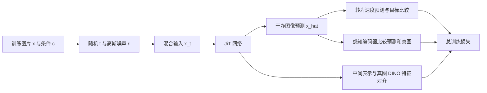

# PixelGen 阅读笔记：从生成过程理解感知监督

阅读对象：有机器学习、推荐系统基础，希望进入像素空间生成研究的读者。

证据状态：2026-10-15 阅读官方论文全文 HTML（v2 正文及附录），并用 `pypdf` 核对本地 25 页 PDF 的方法、实验、附录和统计声明，以及官方仓库相关代码。以下包含论文事实、代码静态检查、独立数学推导和研究假设，分别标明；没有安装环境、运行训练、复现指标或验证 GPU 成本。

本地原文：`literature/pdfs/PixelGen_2602.02493v2.pdf`；[固定版本 PDF 下载](https://arxiv.org/pdf/2602.02493v2)。**HTML 和 PDF 的表格编号不完全一致**，下文以 PDF 编号为准，并附 HTML 对照：PDF Table 1 = HTML Table 1；PDF Table 2/3 分别是无 CFG/有 CFG 类生图表；PDF Table 4 = HTML Table 2（T2I）；PDF Table 5 = HTML Table 3（消融）；PDF Table 6 = HTML Table 4（配置）。这不是指标变化，不能只凭表号定位。

建议用 45–60 分钟完成第一遍：先用 25–30 分钟读本笔记 §1–5，把参数化、速度损失与感知分支讲清；用 10–15 分钟读 §6–7，对照 PDF 第 4–9 页；最后用 10–15 分钟回答 §11 的三题，再看 §12 答案。§8–10 和 §13 作为核查索引与进一步研究时的参考。

## 1. 先看完整问题

推荐系统通常给定用户与候选物品，输出评分或排序。图像生成面对更大的输出空间：给定类别或文本条件，要输出整张 RGB 图片，而且同一条件应当允许许多合理答案。模型既要生成看起来真实的图，也要覆盖多种构图、姿态和背景。

一种构建生成器的方法是：先抽取高斯噪声，再反复用网络估计朝真实图像分布移动的方向，最后得到图片。这是理解本篇流匹配（Flow Matching）的入口。它与常见扩散模型（Diffusion Model）共享逐步从噪声生成数据的框架，但具体训练路径、目标和采样方程要按本文约定读，不能套用所有 DDPM 公式。

潜空间扩散（Latent Diffusion）先把图片编码为压缩表示，在压缩空间生成，再解码。像素空间扩散（Pixel-space Diffusion）直接在 RGB 数组上生成。本篇属于后者。像素空间维数很高，但“维数高”不等于每一维都包含同样重要的视觉信息。例如猫的轮廓与毛发纹理、相机传感器噪声，对人类判断猫图是否真实的贡献不同。

**论文核心设计定位**：在 JiT 的干净图像输出之上，加 LPIPS、P-DINO 及噪声门控；REPA 是已有辅助项，不是本篇新提出的损失。[v2 §3](https://arxiv.org/html/2602.02493v2#S3)

图中的感知编码器是训练时的监督工具。生成新图片时没有对应的真图，不计算这一对图像的训练损失。

## 2. 符号与时间方向

| 符号 | 含义 | 容易混淆之处 |
| --- | --- | --- |
| $x$ | 数据集中的干净图片 | 训练时已知；生成时未知 |
| $\epsilon$ | 随机高斯噪声 | 是图片形状的张量，不是一个标量 |
| $t$ | 生成路径上的连续位置 | 本文 $0$ 是噪声，$1$ 是数据 |
| $x_t$ | 当前路径状态 | 训练时人工混合；采样时迭代产生 |
| $c$ | 类别或文本条件 | 不包含训练真图本身 |
| $\hat x_\theta$ | 网络输出的干净图片估计 | 是输出参数化，不等于实际使用普通 $x$-MSE |
| $v_\theta$ | 由网络输出换算的速度场 | 用于基础损失和生成时数值积分 |
| $g(t)$ | 是否启用感知监督的门 | 控制训练辅助损失，不是采样开关 |

本文约定为 $x_t=t x+(1-t)\epsilon$。因此小 $t$ 噪声多，大 $t$ 噪声少。若读另一篇论文发现 $x_t=(1-t)x+t\epsilon$，其时间方向相反，阈值含义也会反过来。[v2 §3.1，Eq. 2](https://arxiv.org/html/2602.02493v2#S3.SS1)

一个独立的标量练习：设真实像素 $x=0.8$，噪声 $\epsilon=-0.4$。

| $t$ | $x_t$ | 解释 |
| --- | --- | --- |
| 0 | -0.4 | 纯噪声端 |
| 0.25 | -0.1 | 噪声权重 0.75 |
| 0.5 | 0.2 | 两端各一半 |
| 0.75 | 0.5 | 数据权重 0.75 |
| 1 | 0.8 | 数据端 |

这是解释线性插值的数学例子，不是实际模型输出。真实图片中各像素、物体及背景相互关联。

## 3. 最关键的区别：输出 $x$，基础损失优化 $v$

官方实现入口：[REPATrainer](https://github.com/Zehong-Ma/PixelGen/blob/main/src/diffusion/flow_matching/training_repa_JiT_LPIPS_DINO_NoiseGating.py)。`_impl_trainstep` 获取 `pred_img` 后，将它换算为速度；`fm_loss` 比较的是换算后的速度和目标速度。论文对应 §3.1 Eq. 1–5。

令 $\hat x_\theta=\operatorname{net}_\theta(x_t,t,c)$。沿上述直线路径求导，得到独立推导：

$$\frac{d x_t}{dt}=x-\epsilon=v.$$

又因为 $x-x_t=(1-t)(x-\epsilon)$，所以在 $t<1$ 时：

$$v=\frac{x-x_t}{1-t},\qquad v_\theta=\frac{\hat x_\theta-x_t}{1-t}.$$

两者相减，$x_t$ 抵消：

$$v_\theta-v=\frac{\hat x_\theta-x}{1-t}.$$

因此基础平方误差等价于：

$$\mathcal L_{\mathrm{FM}}=\mathbb E\left[\frac{\|\hat x_\theta-x\|^2}{(1-t)^2}\right].$$

**这是随时间加权的图像误差，而不是直接对所有时间使用相同权重的图像 MSE。** 在固定 $t$ 下，两种平方误差只差一个常数；跨不同 $t$ 联合训练时，权重影响优化分配。改变输出参数化和改变训练目标是两个不同决定。

继续上面的练习：在 $t=0.5$，$x_t=0.2$；如果网络预测 $\hat x=0.7$，则目标速度为 $1.2$，预测速度为 $1.0$。速度误差平方为 $0.04$，等于图像误差平方 $0.01$ 除以 $0.5^2$。同样大小的图像误差若发生在 $t=0.9$，速度误差平方会变成 $1.0$。

### 分母截断：理论公式与工程实现

代码在目标速度和预测速度两边都使用 `clamp_min(self.t_eps)`，官方配置 `t_eps: 0.05`。故实际基础项对应：

$$\mathcal L_{\mathrm{FM,code}}=\operatorname{mean}\frac{(\hat x_\theta-x)^2}{\max(1-t,0.05)^2}.$$

这里默认 `loss_weight_fn=constant`、配置使用线性路径。注意：当 $1-t<0.05$，代码中的目标换算速度不再严格等于直线路径导数 $x-\epsilon$；但是两边共享同一分母，因此上述“截断后的加权图像误差”等式仍成立。这个差别比笼统说“做数值稳定处理”更精确。[官方训练代码](https://github.com/Zehong-Ma/PixelGen/blob/main/src/diffusion/flow_matching/training_repa_JiT_LPIPS_DINO_NoiseGating.py#L141)，[XL 配置](https://github.com/Zehong-Ma/PixelGen/blob/main/configs_c2i/PixelGen_XL.yaml#L81)

### 不要把网络一次预测当作一步生成

在训练中网络看过许多噪声程度，学到每个状态该如何估计图像。采样中仍需反复调用网络并积分速度。`x`-prediction 描述输出的语义；一步或多步生成描述采样过程。两者不能互相替代。

## 4. 三条监督线路：各自对齐什么

| 项目 | 预测侧 | 目标侧 | 是否直接比较图片输出 | 主要区别 |
| --- | --- | --- | --- | --- |
| Flow Matching | 从 $\hat x$ 换算的速度 | 真图和当前状态换算的目标速度 | 间接 | 基础生成路径学习 |
| LPIPS | $\hat x$ 的 VGG 多层特征 | 同一训练真图的 VGG 特征 | 是 | 多层局部感知差异 |
| P-DINO | $\hat x$ 的 DINO patch 特征 | 同一真图的 DINO patch 特征 | 是 | 最后层语义表示的余弦差异 |
| REPA | 生成器中间层 token，经投影 | 真图 DINO patch 特征 | 否 | 监督生成器内部表示 |

表中前三条与 REPA 的代码连接见[官方训练器](https://github.com/Zehong-Ma/PixelGen/blob/main/src/diffusion/flow_matching/training_repa_JiT_LPIPS_DINO_NoiseGating.py#L143)。不要因为 P-DINO 与 REPA 都用 DINO，就把它们当成同一个损失。

### LPIPS：在特征里比较图片

LPIPS（Learned Perceptual Image Patch Similarity）直觉上让两张图片进入同一个已训练好的视觉网络，再比较不同层看到的结构。用熟悉的推荐系统语言类比，它类似于从原始 ID 或数值比较切换到表示空间比较；但它不是召回检索，也不是拿一个候选池挑图片。

官方 trainer 实际调用外部 `lpips.LPIPS(net='vgg')` 并冻结参数。它比较 `pred_img` 与归一化图片 `x`。因此不能看到 `src/models/encoder.py` 另有自定义 `LPIPS` 类，就误以为当前配置在用那个类。[LPIPS 调用位置](https://github.com/Zehong-Ma/PixelGen/blob/main/src/diffusion/flow_matching/training_repa_JiT_LPIPS_DINO_NoiseGating.py#L64)

论文 §3.2 的表达式省略了特征归一化与空间平均；实际 LPIPS 不能随意替换成“任意 VGG 特征直接平方误差”。理解目标可写作 $d_{\mathrm{LPIPS}}(\hat x,x)$，需要复现时再核对版本与完整预处理。

### P-DINO：同位置 patch 的语义对齐

P-DINO 用冻结 DINOv2-B 的最后层 patch 特征，比较预测图片与训练真图。论文 §3.3 Eq. 8 中的余弦损失可理解为：

$$d_{\mathrm{DINO}}(\hat x,x)=\frac1P\sum_{p=1}^P\left(1-\frac{f_p(\hat x)^\top f_p(x)}{\|f_p(\hat x)\|\|f_p(x)\|}\right).$$

余弦比较方向，弱化特征模长。目标是同一训练样本的 patch 对齐，不是“生成图与文本余弦一致”，也不是 CLIP 图文训练。高层 patch 特征带有上下文，因此可以提供场景语义信息；“全局语义”也不意味着只比较单个 CLS token。

代码把 `pred_img` 从约定的 `[-1,1]` 转为 `(pred_img+1)/2`，再进入 DINO；真图使用 `metadata['raw_image']`。DINO wrapper 做 ImageNet 标准化并缩放以匹配 patch 网格。`dino_layers=[11]` 是从零计数的最后一层；不能把它读成“论文选择第 11 层”。[DINO wrapper](https://github.com/Zehong-Ma/PixelGen/blob/main/src/models/encoder.py#L36)，[数据预处理](https://github.com/Zehong-Ma/PixelGen/blob/main/src/data/dataset/imagenet.py#L79)

### 冻结参数不等于切断预测分支梯度

对真图提取目标特征可以使用 `torch.no_grad()`；对预测图提取特征仍需保留到预测图的梯度。若整个预测特征提取都放入 `no_grad()`，感知损失便无法改善生成器。冻结视觉网络参数意味着不更新这个编码器，仍可通过它对输入求导。这是从推荐系统常见“冻结教师表示”迁移过来时值得核查的实现点。

## 5. 噪声门控：让监督适用于当前信息量

论文门控为 $g(t)=\mathbf 1[t\ge0.3]$，施加于两个感知项，FM 和 REPA 仍保留。[v2 §3.4](https://arxiv.org/html/2602.02493v2#S3.SS4)

独立直觉：同一份很强的噪声输入可能对应许多合理图片。此时强迫输出精确贴合这一次抽到的真图感知特征，可能对歧义很大的输入施加过强限制。低噪声输入已经泄露更多真实结构，配对感知监督更有针对性。这是解释设计的直觉，不是严格的分布覆盖定理。

“低噪声 70%”指时间轴区间 $[0.3,1]$ 的长度，不是训练样本占比一定等于 70%。官方代码先抽取正态变量，再取 sigmoid：

$$s\sim\mathcal N(-0.8,0.8^2),\quad t=\operatorname{sigmoid}(s).$$

独立计算得到，在训练 `timeshift=1` 时，$\Pr(t\ge0.3)=\Pr(s\ge\operatorname{logit}(0.3))\approx52.4\%$。所以默认 batch 中约一半样本达到阈值，不能用均匀分布的 70% 来估计感知计算量。训练抽样分布与采样时间网格的 `timeshift` 也不是同一件事。[训练时取样](https://github.com/Zehong-Ma/PixelGen/blob/main/src/diffusion/flow_matching/training_repa_JiT_LPIPS_DINO_NoiseGating.py#L130)

### 静态检查：门控公式与官方实现存在需要复核的差别

论文简式是每个样本乘门，再作期望；代码 LPIPS 对有效样本数归一化：$\sum_i g_i\ell_i/\sum_i g_i$。若论文式按整个 batch 平均，则是 $\sum_i g_i\ell_i/B$。前者消除了有效样本比例对平均损失尺度的影响，因此相同 `lambda` 的含义不完全相同。

更具体的**P-DINO masking 静态疑点**：代码 `compute_dino_loss` 先把 mask reshape 为 `[B,1,1]`，而常规 patch 特征 `[B,P,D]` 经 `cosine_similarity(..., dim=-1)` 得 `[B,P]`。二者相乘按广播规则得到 `[B,B,P]`。随后沿 `(1,2)` 平均，会把样本相似度混入另一条 batch 轴；mask 不再逐样本对应。这意味着该分支需要独立检查才能作为复现依据。[问题位置，1 基行号 100–105](https://github.com/Zehong-Ma/PixelGen/blob/main/src/diffusion/flow_matching/training_repa_JiT_LPIPS_DINO_NoiseGating.py#L100)

一个条件静态验证：在 bundled Python 的 NumPy 中建立 `sim=[[0.2,0.2,0.2],[0.8,0.8,0.8]]`、mask 为 $[0,1]$，模拟代码同样的广播与归约。实际打印相乘形状 `(2,2,3)`，代码式损失 `0.5`，逐样本式损失约 `0.2`。这里相似度数值合法，但它只是独立小数组验证，尚未运行官方张量代码、真实 DINO 或训练作复现。若 batch 全部无有效样本，代码还能返回常数 DINO 损失 1 而非 0；其梯度为 0，与日志数值为 0 是不同问题。不要据此断言论文指标必然由此造成。

另外，代码先对整个 batch 计算特征再应用 mask；“关闭高噪声损失”不等于跳过高噪声图片的编码器前向计算。显存和耗时需实际测量。

## 6. 一次训练与一次生成分别发生什么

### 训练：有真图，随机抽一个噪声程度

1. 读取真图及条件；同时保留 `[-1,1]` 的训练像素与 `[0,1]` 的 DINO 输入。
2. 抽取 $t$ 与同形状噪声，人工构建 $x_t$。
3. 网络输出 $\hat x$，并返回用于 REPA 的中间 token。
4. 换算速度，计算 FM；计算两条图片感知差异及中间表示对齐。
5. 根据门控及权重组合，反向传播并更新生成器和投影层；感知编码器不更新。

这与生成时“噪声走 50 步”不同。一个训练 batch 不需要先完整采样整张图，再拿最终图监督。

论文总目标结构为：

$$\mathcal L=\mathcal L_{\mathrm{FM}}+g(t)(\lambda_1\mathcal L_{\mathrm{LPIPS}}+\lambda_2\mathcal L_{\mathrm{P-DINO}})+\mathcal L_{\mathrm{REPA}}.$$

官方 XL 配置取 `lpips_weight=0.1`、`dino_weight=0.01`；trainer 中 REPA 的 `feat_loss_weight` 默认 0.5。此外在 `global_step>=400000` 且每 50 步，代码基于生成器最后层梯度范数更新感知项自适应权重，并作缓存平滑。这些都属于复现应记录的实际目标，而不仅是论文简式的两个 lambda。[配置](https://github.com/Zehong-Ma/PixelGen/blob/main/configs_c2i/PixelGen_XL.yaml#L66)，[实际最终损失](https://github.com/Zehong-Ma/PixelGen/blob/main/src/diffusion/flow_matching/training_repa_JiT_LPIPS_DINO_NoiseGating.py#L166)

### 生成：没有真图，反复积分模型速度

从噪声 $z_0\sim\mathcal N(0,I)$ 开始，在 $t_0=0<\cdots<t_K=1$ 的网格上更新。最简单的 Euler 示例：

$$\hat x_k=\operatorname{net}_\theta(z_k,t_k,c),\quad v_k=\frac{\hat x_k-z_k}{\max(1-t_k,0.05)},\quad z_{k+1}=z_k+(t_{k+1}-t_k)v_k.$$

采样时 $z_k$ 是网络逐步产生的状态，不能当作某张已知真图和噪声的训练插值。Heun 在预测后加入斜率校正；Adams 方法使用多步信息。数值积分器（ODE Solver）不等于优化器 Adam，仓库文件名 `adam_sampling.py` 需要按实现理解。

CFG（Classifier-Free Guidance，无分类器引导）把有条件与空条件的速度组合为 $v_u+w(v_c-v_u)$。$w=1$ 得到有条件速度；提高 $w$ 是额外引导，不是“更准确地计算训练真速度”。CFG 可能改变质量与覆盖的平衡。[CFG 实现](https://github.com/Zehong-Ma/PixelGen/blob/main/src/diffusion/base/guidance.py#L3)

公开配置中 XL 用 Heun 50 步、CFG 2.25、采样 `timeshift=2`；T2I SFT 配置使用 `AdamLMSamplerJiT`、order 2、25 步、CFG 4、`timeshift=3`。这些是不同实验设置，不应统一写成“PixelGen 默认 50 步”。[XL 采样配置](https://github.com/Zehong-Ma/PixelGen/blob/main/configs_c2i/PixelGen_XL.yaml#L86)，[T2I 采样配置](https://github.com/Zehong-Ma/PixelGen/blob/main/configs_t2i/sft_res512.yaml#L82)

## 7. 什么证据支持什么结论

下表仅摘取用于辨别实验协议的关键值；均为作者报告，并非本地复现。[v2 §4](https://arxiv.org/html/2602.02493v2#S4)，本地 PDF 第 7–9 页。

| 证据 | 实验条件 | 值 | 合理结论与边界 |
| --- | --- | --- | --- |
| Table 1 | L/16、ImageNet256、200K、无 CFG | JiT+REPA（论文基线）FID 23.67 → PixelGen 7.53 | 该固定协议下训练监督改善；不是原始 JiT 不带 REPA 的结果 |
| PDF Table 5a / HTML Table 3a | 同协议消融 | 加 LPIPS 10.00；再加 P-DINO 7.46；再 gate 7.53 | 三者递进，gate 并非 FID 单项最优 |
| PDF Table 5a / HTML Table 3a | 上述后两行 Recall | 0.58 → 0.60 | 门控改善覆盖，仍低于基线 0.63 |
| §4.2 | XL/16、ImageNet256、80 epochs、无 CFG | FID 5.11 | 不属于 Table 1 的 L/16 200K 结果 |
| §4.2 | XL/16、160 epochs、有 CFG | FID 1.83 | 不能据此宣称全面超过所有 latent 模型 |
| PDF Table 4 / HTML Table 2 | XXL/16、512 分辨率、T2I | GenEval overall 0.79 | 图文组合 benchmark；不是视频质量指标 |

FID 是生成分布与参考分布在特征统计上的差异，越低通常越好；它不是逐图“真实概率”。这里的生成 Recall 指生成分布覆盖真实样本的程度，与推荐系统“相关物品被召回的比例”不是同一个计算定义。GenEval 则评估提示中物体、计数、颜色、位置等组合要求；不能把 0.79 解读为“79% 的全部生成体验成功”。这些是阅读评价指标时的通用辨析。

最值得注意的是：门控后 FID 略升、Recall 上升。这不是矛盾，两个指标衡量不同性质。如果只挑最低 FID，可能错过本文主动保留分布覆盖的设计。

### 证据不足以支持的说法

- 不是“像素空间模型在所有条件下必然优于潜空间模型”；不同数据、规模、算力和 CFG 协议限制跨系统比较。
- 不是“没有任何预训练依赖”：训练仍依赖冻结视觉编码器，T2I 还使用文本编码器。
- 不是“已经证明视频生成有效”：本文实验是图像任务，没有时间连续性实验。
- 不是“从零训练适合个人 GPU”：公开规模与大规模预训练数据远大于入门验证。
- 不是“有官方代码即可保证结果复现”：还需固定版本、依赖、数据处理、checkpoint 和评估程序。

论文没有报告误差条或重复完整训练的显著性检验，故不要把很小的单次差异解释成稳定优胜。[v2 NeurIPS checklist，Experimental statistical significance](https://arxiv.org/html/2602.02493v2)，PDF 第 21–22 页。

### 算力和阶段：先知道成本指什么

PDF Table 1（第 7 页）报告相同 L/16 对比中，JiT → PixelGen 的单步时间为 0.19 → 0.20 s，显存 29.5 → 33.9 GB，推理均为 0.32 s/image。这说明该协议的感知监督训练开销，并不是所有硬件上的保证，也不是个人设备实际测得的占用。

文生图 PDF §4.3、Appendix B.3（第 8、15 页）报告三阶段：256 分辨率预训练 200K 步；512 预训练 80K 步；BLIP3o-60k 上 512 微调 40K 步。整体使用 8 张 H800、约 6 天。条件编码用 Qwen3-1.7B 的冻结特征，再联合训练其上的若干 transformer 层。不能因这些层可训练，就说整个 Qwen3 文本编码器都被联合更新。

当前用户可用 GPU、显存、预算和数据权限未知，因此本笔记没有安排训练或声称复现可行。阅读笔记和实现检查是已完成的证据层，运行预算需要后续确定。

## 8. 全文各部分应如何使用

| 位置 | PDF 页码 | 用途 | 阅读动作 |
| --- | --- | --- | --- |
| §1–2 | 1–3 | 问题定位、JiT 与已有感知目标的关系 | 区分动机、已有机制和新增设计 |
| §3.1 | 4 | 参数化、路径、目标 | 手算一次 $x$ 到 $v$ 转换 |
| §3.2–3.3 | 5 | 两条图片输出监督 | 看清每条分支的输入、目标和梯度 |
| §3.4 | 6 | 门控 | 先检查时间方向，再看阈值 |
| §4.1–4.4 | 6–9 | 实验及消融 | 比较同表同协议，避免跨配置拼接 |
| §5 | 9 | 结论边界 | 结合 CFG 差距与编码器依赖阅读 |
| Appendix A | 14 | 感知梯度分析 | 是经验解释，不能升级成理论证明 |
| Appendix B | 14–15 | 配置与训练阶段 | 与实际 YAML 对照，记录差别 |
| Appendix C、E | 16、17–18 | 提示词与更多样例 | 定性例子不替代完整基准评估 |
| Appendix D | 16 | 训练及采样伪代码 | 作为路径图，工程细节仍需代码 |
| Checklist | 19–25 | 作者证据声明 | 检查统计验证与可复现性边界 |

全文入口：[PixelGen v2 HTML](https://arxiv.org/html/2602.02493v2)。上表是阅读导航，而非各节的逐段转述。

## 9. 论文版本、仓库与配置的区别

arXiv v1（2026-02-02）标题为 *PixelGen: Pixel Diffusion Beats Latent Diffusion with Perceptual Loss*；v2（2026-05-07）标题为 *PixelGen: Improving Pixel Diffusion with Perceptual Supervision*。仓库 README 与 About 仍使用 *PixelGen: Improving Pixel Diffusion with Perceptual Loss*。按 arXiv 编号 2602.02493 和官方仓库对应，而不要仅按标题匹配。[v1](https://arxiv.org/html/2602.02493v1)，[版本历史](https://arxiv.org/abs/2602.02493)，[仓库](https://github.com/Zehong-Ma/PixelGen)

本笔记的方法解释以 v2 为准。本文只确认版本标题与日期，不把所有正文变化都归因于某次实验更新。当前代码引用指向 `main`，未固定 commit；后续复现必须记录具体 SHA，不能把今天的网页快照当成不可变代码版本。

还有两个容易误读的工程细节：

- `LightningModel` 里保留名为 `vae` 的通用接口，但公开配置实例化的是 `PixelAE`。其 `encode/decode` 只做 scale/shift 运算，默认 scale 1、shift 0，没有空间压缩或学习型 VAE。变量名字不是架构证据。[PixelAE](https://github.com/Zehong-Ma/PixelGen/blob/main/src/models/autoencoder/pixel.py)
- T2I SFT YAML 的优化器 lr 是 `1e-5`；论文配置表概括为 `1e-4`，且 YAML 的 `max_steps` 和恢复 checkpoint 还涉及累计步骤。公开文件不能机械当作从零运行的完整命令；必须核对各训练阶段及 checkpoint step。[SFT 配置](https://github.com/Zehong-Ma/PixelGen/blob/main/configs_t2i/sft_res512.yaml#L95)

## 10. 向像素空间视频生成迁移：明确是研究假设

可以把视频看成 $X\in\mathbb R^{T\times3\times H\times W}$，沿相同线性路径构建 $X_t$，让模型预测完整干净视频 $\hat X$。这只是数学接口能扩展，尚不说明一个图像模型已学会运动。

| 假设 | 为什么可考虑 | 未解决问题 | 可检验的对照 |
| --- | --- | --- | --- |
| 逐帧 LPIPS/P-DINO | 图片输出可逐帧使用现有视觉编码器 | 帧帧漂亮仍可能闪烁、身份漂移 | 固定视频模型，比较 FM 与逐帧感知项 |
| 加时序感知特征 | 视频表示可能识别运动与跨帧关系 | 新编码器的域偏差、成本和梯度尺度 | 对比逐帧目标与视频特征目标 |
| 重新验证 noise gate | 高噪声视频存在更多运动歧义 | 0.3 未必适用于新时序长度及噪声定义 | 预先指定阈值网格，同时看质量与覆盖 |
| 分层空间/时间 token | 视频 token 数随帧数增加 | 全注意力成本、长程运动能力 | 相同预算比较结构，记录显存和吞吐 |

一个典型反例：逐帧监督可能认为“红球在每一帧都清晰”已很好，但球的位置一会儿左、一会儿右，运动并不合理。单帧 DINO 与 LPIPS 不能自动证明轨迹连续。

迁移验证应把静态外观、时间一致性、运动真实性、条件符合度、覆盖和成本分开记录。为节省成本，可以先在固定的小规模视频模型与同一数据集上做损失对照；这只是可操作的研究设计建议，本工作区尚未开始该实验。

## 11. 三个理解检查

先尝试回答，再看下一节。

1. 若网络输出干净图像，为什么仍能称基础损失为速度空间的 flow-matching loss？把 $t=0.5$ 与 $t=0.9$ 的相同图像误差比较，会发生什么？分母截断后哪里改变？
2. REPA 与 P-DINO 都用冻结 DINO，为什么仍不是同一种监督？预测分支若使用 `torch.no_grad()` 会损失什么？
3. 加 gate 后 FID 从 7.46 变成 7.53，却仍是默认设计，如何解释？如果直接迁移到视频，最少还需验证哪种失败模式？

## 12. 参考答案（与问题分开）

**1.** 输出参数化为 $x$，实际计算先换算为 $v$，故 $v$-MSE 等价于带 $1/(1-t)^2$ 权重的 $x$-MSE。同样图像平方误差，在 0.5 的权重是 4，在 0.9 是 100。代码截断后权重上限是 $1/0.05^2=400$；截断区间的换算目标也不再严格等于直线导数。

**2.** REPA 对齐生成器中间 token 与真图特征；P-DINO 对齐生成图片编码后的特征与真图特征。前者约束内部表示，后者约束输出图片。冻结编码器只阻止其参数更新；对预测分支禁用自动求导则阻断感知损失对生成器的学习信号。

**3.** gate 的目标是质量与覆盖的平衡，Recall 从 0.58 改善到 0.60，而不是让 FID 单项最小。视频至少要验证跨帧闪烁、主体身份与运动连续性；同时要避免仅提高单帧指标、却使运动覆盖下降。该视频答案是迁移推理，不是论文结论。

## 13. 官方代码阅读索引

以下路径均已打开检查；没有在本地执行。

| 路径 | `Ctrl+F` 字符串 | 应回答的问题 |
| --- | --- | --- |
| [configs_c2i/PixelGen_XL.yaml](https://github.com/Zehong-Ma/PixelGen/blob/main/configs_c2i/PixelGen_XL.yaml) | `diffusion_trainer`、`percept_t_threshold`、`diffusion_sampler` | 配置实际选用哪个 trainer/sampler？ |
| [training_repa_JiT_LPIPS_DINO_NoiseGating.py](https://github.com/Zehong-Ma/PixelGen/blob/main/src/diffusion/flow_matching/training_repa_JiT_LPIPS_DINO_NoiseGating.py) | `_impl_trainstep`、`compute_dino_loss`、`clamp_min`、`cached_percept_weight` | 损失、门控、梯度与权重如何实现？ |
| [src/models/encoder.py](https://github.com/Zehong-Ma/PixelGen/blob/main/src/models/encoder.py) | `class DINOv2`、`get_intermediate_feats` | DINO 输入和 patch 网格是什么？ |
| [src/models/transformer/JiT.py](https://github.com/Zehong-Ma/PixelGen/blob/main/src/models/transformer/JiT.py) | `FinalLayer`、`unpatchify`、`return_layer` | Transformer 如何还原 RGB 并提供中间 token？ |
| [src/data/dataset/imagenet.py](https://github.com/Zehong-Ma/PixelGen/blob/main/src/data/dataset/imagenet.py) | `class PixImageNet`、`raw_image` | FM 与 DINO 是否用一致图片、不同数值范围？ |
| [sampling.py](https://github.com/Zehong-Ma/PixelGen/blob/main/src/diffusion/flow_matching/sampling.py) | `HeunSamplerJiT`、`pred v`、`shift_respace_fn` | 输出如何换成采样速度，网格如何变换？ |
| [adam_sampling.py](https://github.com/Zehong-Ma/PixelGen/blob/main/src/diffusion/flow_matching/adam_sampling.py) | `AdamLMSamplerJiT` | 文生图多步采样接口在哪里？ |
| [src/lightning_model.py](https://github.com/Zehong-Ma/PixelGen/blob/main/src/lightning_model.py) | `training_step`、`predict_step` | 数据、条件、trainer、EMA 和 sampler 如何连接？ |
| [src/models/autoencoder/pixel.py](https://github.com/Zehong-Ma/PixelGen/blob/main/src/models/autoencoder/pixel.py) | `_impl_encode`、`_impl_decode` | 名为 vae 的接口是否真的压缩空间？ |
| [configs_t2i/sft_res512.yaml](https://github.com/Zehong-Ma/PixelGen/blob/main/configs_t2i/sft_res512.yaml) | `conditioner`、`optimizer`、`ckpt_path` | 文本条件、SFT lr 与恢复位置是什么？ |
